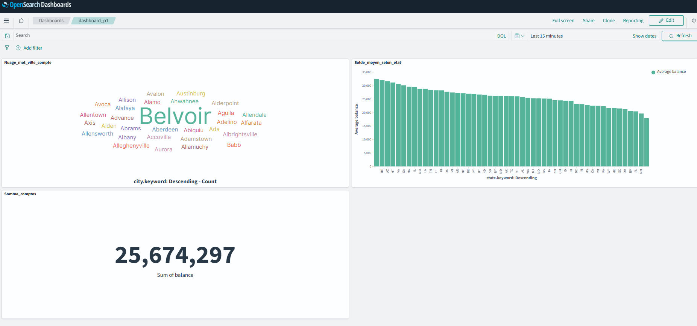

# Introduction

Dans ce TP, vous allez installer la suite ELK (Elasticsearch, Logstash, Kibana) dans sa version open source : **OpenSearch**. Le coeur de cette suite est OpenSearch (fork Elasticsearch), une base NoSQL orientée document mais aussi un moteur de recherche puissant qui est de plus en plus utilisé dans l’industrie ; non seulement pour ses capacités de recherche mais aussi pour ses fonctionnalités de Business Intelligence (BI).

Vous allez travailler sur des données factices représentant des comptes bancaires, des textes de Shakespeare et des news. A l’issue de ce TP, vous serez capable de :
- Déployer un environnement ELK en quelques minutes ;
- Ingérer des documents JSON (semi-structurés) ;
- Construire et exécuter des requêtes ;
- Fabriquer des visualisations permettant d’explorer vos données grâce à OpenSearch Dashboards (fork Kibana) ;
- Intégrer un modèle de TALN pré-entraîné pour répondre à des requêtes sémantiques ;
- Ingérer d’autres formats de données grâce à logstash.

**Evaluation** : L’évaluation portera sur un rapport d’une dizaine de pages dans lequel vous indiquerez _honnêtement_ les réponses aux questions de ce TP. Les questions sont préfixées par `(Question)`.

Le rapport est à soumettre sur Moodle avant la date indiquée.


# Installation de la suite ELK

Le fichier `docker-compose.yml` est fourni à la racine du dépôt. Il décrit l'environnement ELK : 3 conteneurs, un pour OpenSearch, un pour Logstash et un pour OpenSearch Dashboards.

## Images

```
opensearchproject/opensearch:3
opensearchproject/logstash-oss-with-opensearch-output-plugin:8.9.0
opensearchproject/opensearch-dashboards:3
```

## Ports

```
9200 (opensearch/http), 5601 (opensearch-dashboards/http), 5000 (logstash-oss/tcp)
```

## Réseau

```
bridge
```

- (Question) Étudiez le fichier `docker-compose.yml` en vous aidant de la documentation https://docs.opensearch.org/latest/install-and-configure/install-opensearch/docker/. Pour chaque service, expliquez son rôle, les ports exposés et les principaux paramètres (`discovery.type`, `node.roles`, `OPENSEARCH_JAVA_OPTS`, `healthcheck`, `depends_on`). Pourquoi la sécurité est-elle désactivée, et pourquoi ne faut-il jamais le faire en production ?


Reponse : 

Le fichier lance 3 conteneurs sur un réseau bridge opensearch-net, où ils se joignent par leur nom de service.

opensearch stocke, indexe et recherche les documents. Ports 9200 (API REST) et 9600 (Performance Analyzer). discovery.type=single-node : un cluster d’un seul nœud. node.roles : ce nœud cumule les rôles cluster_manager, data, ingest et ml. OPENSEARCH_JAVA_OPTS : tas JVM fixé à 1 Go (Xms = Xmx pour éviter les redimensionnements). healthcheck : interroge /_cluster/health toutes les 30 s.
logstash-oss ingère et transforme les données vers OpenSearch. Port 5000.
opensearch-dashboards est l’interface web. Port 5601.
Les deux derniers ont depends_on avec service_healthy : ils attendent qu’OpenSearch soit prêt avant de démarrer.

La sécurité est désactivée pour simplifier le TP : pas de certificats, pas de mot de passe. En production, ce serait dangereux : sans authentification ni chiffrement, n’importe qui pouvant joindre le port 9200 pourrait lire ou supprimer toutes les données, et les échanges circuleraient en clair.

## Préparation de la machine

OpenSearch a besoin d'un paramètre noyau plus élevé que la valeur par défaut :

- **Linux** :
```
sudo sysctl -w vm.max_map_count=262144
```
Commande à exécuter à chaque redémarrage, ou ajoutez `vm.max_map_count=262144` dans le fichier `/etc/sysctl.conf` pour une configuration permanente.

- **Windows (Docker Desktop avec WSL 2)** :
```
wsl -d docker-desktop sh -c "sysctl -w vm.max_map_count=262144"
```

- **macOS (Docker Desktop)** : en général, rien à faire.

Sous Linux, créez aussi le dossier de données et donnez-le à l'utilisateur du conteneur (UID 1000), sinon OpenSearch ne pourra pas y écrire :

```
mkdir -p docker/opensearch/data
sudo chown -R 1000:1000 docker/opensearch/data
```

**Espace disque** : gardez au moins 10 % d'espace libre. Au-delà de 90 % d'occupation, OpenSearch refuse de créer de nouveaux index (erreur `create-index blocked`) ; au-delà de 95 %, il passe les index existants en lecture seule (erreur `flood-stage watermark`). Libérez de l'espace avant de commencer le TP.

## Lancement

Lancer la commande

```
docker compose up -d
```

pour construire l'environnement (Docker Compose v2 : `docker compose`, sans tiret).

Vérifier le bon fonctionnement de l'environnement en inspectant les logs (`docker compose logs -f opensearch`) et en vous connectant à l'URL http://localhost:9200

# Partie 1 - Gestion de données simples
## Indexation de données

Le jeu de données est fourni dans le dossier `data` : `data/accounts.json`.


Indexer les données dans OpenSearch grâce à la commande suivante :

```
curl -H 'Content-Type: application/x-ndjson' -XPOST 'localhost:9200/bank/_bulk?pretty' --data-binary @data/accounts.json
```

Toutes les données sont alors envoyées dans l’index nommé `bank`.


## Prise en main d'OpenSearch
Se rendre à l’URL http://localhost:5601 puis dans `Dev Tools`.

A l’aide de la documentation disponible au lien ci-dessous, vous allez écrire les requêtes permettant de répondre à différentes questions.

Documentation utile : https://docs.opensearch.org/latest/.

## Requêtage simple 

### INDEX et UPDATE API
- (Question) Après avoir étudié la structure d’un document, ajouter un nouveau compte dont l’ID est 10001

Requete : PUT bank/_doc/10001
{
"account_number": 10001,
"balance": 10,
"firstname":"Jean",
"lastname":"Deux",
"age":20,
"gender":"M",
"address":"Space",
"email":"mail@mail.mail",
"city":"Mycity",
"state":"Mystate"
  
}

Résultat : 

{
  "_index": "bank",
  "_id": "10001",
  "_version": 1,
  "result": "created",
  "_shards": {
    "total": 2,
    "successful": 1,
    "failed": 0
  },
  "_seq_no": 1000,
  "_primary_term": 1
}

- (Question) Mettre à jour le compte précédent en modifiant l’adresse

Requete :

POST bank/_update/10001
{
  "doc": { "address": "12 rue de la Paix" }
}

Résultat : 

{
  "_index": "bank",
  "_id": "10001",
  "_version": 2,
  "result": "updated",
  "_shards": {
    "total": 2,
    "successful": 1,
    "failed": 0
  },
  "_seq_no": 1001,
  "_primary_term": 1
}

### DELETE API
- (Question) Supprimer le compte précédemment créé

Requete :

DELETE bank/_doc/10001

Résultat : 

{
  "_index": "bank",
  "_id": "10001",
  "_version": 3,
  "result": "deleted",
  "_shards": {
    "total": 2,
    "successful": 1,
    "failed": 0
  },
  "_seq_no": 1002,
  "_primary_term": 1
}

- (Question) Supprimer tous les comptes de la ville de Nicholson (Utiliser _delete_by_query)

Requete : 

POST bank/_delete_by_query
{
  "query": {
    "term": { "city.keyword": "Nicholson" }
  }
}

Resultat : 

{
  "took": 94,
  "timed_out": false,
  "total": 1,
  "deleted": 1,
  "batches": 1,
  "version_conflicts": 0,
  "noops": 0,
  "retries": {
    "bulk": 0,
    "search": 0
  },
  "throttled_millis": 0,
  "requests_per_second": -1,
  "throttled_until_millis": 0,
  "failures": []
}


### GET API
- (Question) Obtenir le compte dont l’ID est 2

Requete : 

GET bank/_doc/2


Résultat : 

{
  "_index": "bank",
  "_id": "2",
  "_version": 1,
  "_seq_no": 200,
  "_primary_term": 1,
  "found": true,
  "_source": {
    "account_number": 2,
    "balance": 28838,
    "firstname": "Roberta",
    "lastname": "Bender",
    "age": 22,
    "gender": "F",
    "address": "560 Kingsway Place",
    "employer": "Chillium",
    "email": "robertabender@chillium.com",
    "city": "Bennett",
    "state": "LA"
  }
}

- (Question) Idem mais récupérer uniquement le source (champs _source)

Requete :

GET bank/_source/2

Resultat :


{
  "account_number": 2,
  "balance": 28838,
  "firstname": "Roberta",
  "lastname": "Bender",
  "age": 22,
  "gender": "F",
  "address": "560 Kingsway Place",
  "employer": "Chillium",
  "email": "robertabender@chillium.com",
  "city": "Bennett",
  "state": "LA"
}


- (Question) Idem mais en ne sélectionnant que le nom et le prénom (firstname, lastname)

Requete : 

GET bank/_doc/2?_source=firstname,lastname

Resultat :

{
  "_index": "bank",
  "_id": "2",
  "_version": 1,
  "_seq_no": 200,
  "_primary_term": 1,
  "found": true,
  "_source": {
    "firstname": "Roberta",
    "lastname": "Bender"
  }
}


### SEARCH API
- (Question) Retrouver tous les comptes

Requete : 

GET bank/_search
{
  "query": {
    "match_all": {}
  }
}

Resultat : 

{
  "took": 10,
  "timed_out": false,
  "_shards": {
    "total": 1,
    "successful": 1,
    "skipped": 0,
    "failed": 0
  },
  "hits": {
    "total": {
      "value": 999,
      "relation": "eq"
    },
    "max_score": 1,
    "hits": [
      {
        "_index": "bank",
        "_id": "1",
        "_score": 1,
        "_source": {
          "account_number": 1,
          "balance": 39225,
          "firstname": "Amber",
          "lastname": "Duke",
          "age": 32,
          "gender": "M",
          "address": "880 Holmes Lane",
          "employer": "Pyrami",
          "email": "amberduke@pyrami.com",
          "city": "Brogan",
          "state": "IL"
        }
      },
      {
        "_index": "bank",
        "_id": "6",
        "_score": 1,
        "_source": {
          "account_number": 6,
          "balance": 5686,
          "firstname": "Hattie",
          "lastname": "Bond",
          "age": 36,
          "gender": "M",
          "address": "671 Bristol Street",
          "employer": "Netagy",
          "email": "hattiebond@netagy.com",
          "city": "Dante",
          "state": "TN"
        }
      },
      {
        "_index": "bank",
        "_id": "13",
        "_score": 1,
        "_source": {
          "account_number": 13,
          "balance": 32838,
          "firstname": "Nanette",
          "lastname": "Bates",
          "age": 28,
          "gender": "F",
          "address": "789 Madison Street",
          "employer": "Quility",
          "email": "nanettebates@quility.com",
          "city": "Nogal",
          "state": "VA"
        }
      },
      {
        "_index": "bank",
        "_id": "18",
        "_score": 1,
        "_source": {
          "account_number": 18,
          "balance": 4180,
          "firstname": "Dale",
          "lastname": "Adams",
          "age": 33,
          "gender": "M",
          "address": "467 Hutchinson Court",
          "employer": "Boink",
          "email": "daleadams@boink.com",
          "city": "Orick",
          "state": "MD"
        }
      },
      {
        "_index": "bank",
        "_id": "20",
        "_score": 1,
        "_source": {
          "account_number": 20,
          "balance": 16418,
          "firstname": "Elinor",
          "lastname": "Ratliff",
          "age": 36,
          "gender": "M",
          "address": "282 Kings Place",
          "employer": "Scentric",
          "email": "elinorratliff@scentric.com",
          "city": "Ribera",
          "state": "WA"
        }
      },
      {
        "_index": "bank",
        "_id": "32",
        "_score": 1,
        "_source": {
          "account_number": 32,
          "balance": 48086,
          "firstname": "Dillard",
          "lastname": "Mcpherson",
          "age": 34,
          "gender": "F",
          "address": "702 Quentin Street",
          "employer": "Quailcom",
          "email": "dillardmcpherson@quailcom.com",
          "city": "Veguita",
          "state": "IN"
        }
      },
      {
        "_index": "bank",
        "_id": "37",
        "_score": 1,
        "_source": {
          "account_number": 37,
          "balance": 18612,
          "firstname": "Mcgee",
          "lastname": "Mooney",
          "age": 39,
          "gender": "M",
          "address": "826 Fillmore Place",
          "employer": "Reversus",
          "email": "mcgeemooney@reversus.com",
          "city": "Tooleville",
          "state": "OK"
        }
      },
      {
        "_index": "bank",
        "_id": "44",
        "_score": 1,
        "_source": {
          "account_number": 44,
          "balance": 34487,
          "firstname": "Aurelia",
          "lastname": "Harding",
          "age": 37,
          "gender": "M",
          "address": "502 Baycliff Terrace",
          "employer": "Orbalix",
          "email": "aureliaharding@orbalix.com",
          "city": "Yardville",
          "state": "DE"
        }
      },
      {
        "_index": "bank",
        "_id": "49",
        "_score": 1,
        "_source": {
          "account_number": 49,
          "balance": 29104,
          "firstname": "Fulton",
          "lastname": "Holt",
          "age": 23,
          "gender": "F",
          "address": "451 Humboldt Street",
          "employer": "Anocha",
          "email": "fultonholt@anocha.com",
          "city": "Sunriver",
          "state": "RI"
        }
      },
      {
        "_index": "bank",
        "_id": "51",
        "_score": 1,
        "_source": {
          "account_number": 51,
          "balance": 14097,
          "firstname": "Burton",
          "lastname": "Meyers",
          "age": 31,
          "gender": "F",
          "address": "334 River Street",
          "employer": "Bezal",
          "email": "burtonmeyers@bezal.com",
          "city": "Jacksonburg",
          "state": "MO"
        }
      }
    ]
  }
}


- (Question) Retrouver tous les comptes dont la ville (champs city) est Belvoir

Requete : 

GET bank/_search
{
  "query": {
    "match": {
      "city":"Belvoir"
    }
  }
}

Resultat : 

{
  "took": 10,
  "timed_out": false,
  "_shards": {
    "total": 1,
    "successful": 1,
    "skipped": 0,
    "failed": 0
  },
  "hits": {
    "total": {
      "value": 2,
      "relation": "eq"
    },
    "max_score": 2.7249608,
    "hits": [
      {
        "_index": "bank",
        "_id": "108",
        "_score": 2.7249608,
        "_source": {
          "account_number": 108,
          "balance": 19015,
          "firstname": "Christensen",
          "lastname": "Weaver",
          "age": 21,
          "gender": "M",
          "address": "398 Dearborn Court",
          "employer": "Quilk",
          "email": "christensenweaver@quilk.com",
          "city": "Belvoir",
          "state": "TX"
        }
      },
      {
        "_index": "bank",
        "_id": "999",
        "_score": 2.7249608,
        "_source": {
          "account_number": 999,
          "balance": 6087,
          "firstname": "Dorothy",
          "lastname": "Barron",
          "age": 22,
          "gender": "F",
          "address": "499 Laurel Avenue",
          "employer": "Xurban",
          "email": "dorothybarron@xurban.com",
          "city": "Belvoir",
          "state": "CA"
        }
      }
    ]
  }
}


- (Question) Retrouver tous les comptes dont la ville (champs city) est Belvoir ET l’employeur Xurban

Requete : 

GET bank/_search
{
  "query": {
    "bool": {
      "must": [
        { "match": { "city": "Belvoir" } },
        { "match": { "employer": "Xurban" } }
      ]
    }
  }
}

Resultat :

{
  "took": 41,
  "timed_out": false,
  "_shards": {
    "total": 1,
    "successful": 1,
    "skipped": 0,
    "failed": 0
  },
  "hits": {
    "total": {
      "value": 1,
      "relation": "eq"
    },
    "max_score": 5.4499216,
    "hits": [
      {
        "_index": "bank",
        "_id": "999",
        "_score": 5.4499216,
        "_source": {
          "account_number": 999,
          "balance": 6087,
          "firstname": "Dorothy",
          "lastname": "Barron",
          "age": 22,
          "gender": "F",
          "address": "499 Laurel Avenue",
          "employer": "Xurban",
          "email": "dorothybarron@xurban.com",
          "city": "Belvoir",
          "state": "CA"
        }
      }
    ]
  }
}


## Visualisation des données avec OpenSearch Dashboards
Avant de créer des visuels, déclarez l'index à OpenSearch Dashboards : menu `Dashboards Management` › `Index patterns` › `Create index pattern`, saisissez `bank`, puis validez.

Aller ensuite sur l’onglet Visualize et créer les visuels suivants :

- (Question) Métrique affichant la somme des soldes de tous les comptes. Sauver le graphique.

Réponse : 

Question : métrique affichant la somme des soldes

Étapes réalisées :

Menu Visualize → Create visualization → type Metric → source bank.  
Dans Metrics, l’agrégation par défaut Count a été remplacée par Sum, sur le champ balance.  
 

la somme des soldes des 999 comptes est de 25 674 297

- (Question) Graphique barre affichant la moyenne des soldes (champ balance) selon l’état (champ state). Sauver le graphique.

Réponse : 

Étapes réalisées :  

Menu Visualize → Create visualization → type Vertical Bar → source bank.  
Axe Y (Metrics) : agrégation Average sur le champ balance.  
Axe X (Buckets → Add → X-axis) :    
agrégation Terms sur le champ state. keyword, triée par la moyenne des soldes en ordre  décroissant, avec Size = 51 pour afficher tous les états.  


- (Question) Nuage de mots représentant les villes dans lesquelles il y a le plus de comptes. Sauver le graphique.

Étapes réalisées :  

Menu Visualize → Create visualization → type Tag Cloud → source bank.  
Métrique : Count, la taille de chaque mot représentant le nombre de comptes.  
Bucket (Tags) : agrégation Terms sur le champ city.keyword, triée par nombre de comptes en ordre décroissant, avec Size = 30.  

Rendez-vous ensuite sur l’onglet Dashboard puis : 

- (Question) Réaliser un tableau de bord regroupant les 3 visuels précédents.  


Étapes réalisées :  

Menu Dashboards → Create new dashboard.  
Add an existing (ou Add),  


- (Question) Exécuter une requête dans la barre de recherche situé au dessus et remarquez que les visuels se mettent automatiquement à jour.

Le visuel ce met à jour en fonction de la requete renvoie le résultat visuel de la requete sur les 3 graphiques.



# Partie 2 - Gestion de documents textuels

Dans cette partie nous allons travailler avec des données principalement textuelles et nous allons palper la puissance d'OpenSearch en tant que moteur de recherche plein texte.

## Indexation de données
- Le jeu de données est fourni dans le dossier `data` : `data/shakespeare_6.0.json`.
- Indexer les données dans OpenSearch grâce à la commande suivante :

```
curl -H 'Content-Type: application/x-ndjson' -XPOST 'localhost:9200/shakespeare/_bulk?pretty' --data-binary @data/shakespeare_6.0.json
```

## Recherches plein texte
OpenSearch est un puissant moteur de recherche capable de gérer des millions de documents sur une unique machine et plusieurs milliards dans un environnement distribué. 

L’objectif des questions ci-dessous est de se rendre compte de ses capacités de recherche et de la rapidité à laquelle les réponses sont données.

### SEARCH API

Répondre aux questions suivantes en utilisant l'API Search.

Documentation : 
- https://docs.opensearch.org/latest/api-reference/search/
- https://docs.opensearch.org/latest/query-dsl/full-text/query-string/

Vous pouvez répondre à toutes les questions en utilisant cette syntaxe :

```
GET shakespeare/_search?q=query OR champ:query
```

- (Question) Rechercher les documents contenant le terme KING dans les champs text_entry OU play_name. Accordez deux fois plus d’importance aux documents qui contiennent le terme dans le champ play_name (astuce : KING^2).

Requete : 

GET shakespeare/_search?q=text_entry:KING OR play_name:KING^2


Resultat : 

{
  "took": 104,
  "timed_out": false,
  "_shards": {
    "total": 1,
    "successful": 1,
    "skipped": 0,
    "failed": 0
  },
  "hits": {
    "total": {
      "value": 7837,
      "relation": "eq"
    },
    "max_score": 5.9573455,
    "hits": [
      {
        "_index": "shakespeare",
        "_id": "51205",
        "_score": 5.9573455,
        "_source": {
          "type": "line",
          "line_id": 51206,
          "play_name": "King Lear",
          "speech_number": 5,
          "line_number": "3.6.11",
          "speaker": "KING LEAR",
          "text_entry": "A king, a king!"
        }
      },
      {
        "_index": "shakespeare",
        "_id": "51923",
        "_score": 5.655861,
        "_source": {
          "type": "line",
          "line_id": 51924,
          "play_name": "King Lear",
          "speech_number": 31,
          "line_number": "4.6.97",
          "speaker": "KING LEAR",
          "text_entry": "king himself."
        }
      },
      {
        "_index": "shakespeare",
        "_id": "44109",
        "_score": 5.494281,
        "_source": {
          "type": "line",
          "line_id": 44110,
          "play_name": "King John",
          "speech_number": 72,
          "line_number": "2.1.321",
          "speaker": "English Herald",
          "text_entry": "King John, your king and Englands doth approach,"
        }
      },
      {
        "_index": "shakespeare",
        "_id": "46199",
        "_score": 5.4502964,
        "_source": {
          "type": "line",
          "line_id": 46200,
          "play_name": "King John",
          "speech_number": 14,
          "line_number": "",
          "speaker": "BASTARD",
          "text_entry": "KING JOHN dies"
        }
      },
      {
        "_index": "shakespeare",
        "_id": "44160",
        "_score": 5.399325,
        "_source": {
          "type": "line",
          "line_id": 44161,
          "play_name": "King John",
          "speech_number": 79,
          "line_number": "2.1.371",
          "speaker": "First Citizen",
          "text_entry": "The king of England; when we know the king."
        }
      },
      {
        "_index": "shakespeare",
        "_id": "49202",
        "_score": 5.272825,
        "_source": {
          "type": "line",
          "line_id": 49203,
          "play_name": "King Lear",
          "speech_number": 46,
          "line_number": "1.1.170",
          "speaker": "KENT",
          "text_entry": "Now, by Apollo, king,"
        }
      },
      {
        "_index": "shakespeare",
        "_id": "49263",
        "_score": 5.272825,
        "_source": {
          "type": "line",
          "line_id": 49264,
          "play_name": "King Lear",
          "speech_number": 60,
          "line_number": "",
          "speaker": "KING LEAR",
          "text_entry": "To KING OF FRANCE"
        }
      },
      {
        "_index": "shakespeare",
        "_id": "49264",
        "_score": 5.272825,
        "_source": {
          "type": "line",
          "line_id": 49265,
          "play_name": "King Lear",
          "speech_number": 60,
          "line_number": "1.1.226",
          "speaker": "KING LEAR",
          "text_entry": "For you, great king,"
        }
      },
      {
        "_index": "shakespeare",
        "_id": "49816",
        "_score": 5.272825,
        "_source": {
          "type": "line",
          "line_id": 49817,
          "play_name": "King Lear",
          "speech_number": 74,
          "line_number": "",
          "speaker": "Fool",
          "text_entry": "Pointing to KING LEAR"
        }
      },
      {
        "_index": "shakespeare",
        "_id": "49921",
        "_score": 5.272825,
        "_source": {
          "type": "line",
          "line_id": 49922,
          "play_name": "King Lear",
          "speech_number": 94,
          "line_number": "",
          "speaker": "GONERIL",
          "text_entry": "Re-enter KING LEAR"
        }
      }
    ]
  }
}


- (Question) Rechercher les documents où l’orateur (champ speaker) CAESAR parle de Brutus (champ text_entry)

Requete :

GET shakespeare/_search?q=speaker:CAESAR AND text_entry:Brutus


Resultat : 

{
  "took": 16,
  "timed_out": false,
  "_shards": {
    "total": 1,
    "successful": 1,
    "skipped": 0,
    "failed": 0
  },
  "hits": {
    "total": {
      "value": 7,
      "relation": "eq"
    },
    "max_score": 6.757757,
    "hits": [
      {
        "_index": "shakespeare",
        "_id": "47513",
        "_score": 6.757757,
        "_source": {
          "type": "line",
          "line_id": 47514,
          "play_name": "Julius Caesar",
          "speech_number": 28,
          "line_number": "3.1.59",
          "speaker": "CAESAR",
          "text_entry": "What, Brutus!"
        }
      },
      {
        "_index": "shakespeare",
        "_id": "47292",
        "_score": 6.455456,
        "_source": {
          "type": "line",
          "line_id": 47293,
          "play_name": "Julius Caesar",
          "speech_number": 14,
          "line_number": "",
          "speaker": "CAESAR",
          "text_entry": "Enter DECIUS BRUTUS"
        }
      },
      {
        "_index": "shakespeare",
        "_id": "47536",
        "_score": 5.9668665,
        "_source": {
          "type": "line",
          "line_id": 47537,
          "play_name": "Julius Caesar",
          "speech_number": 34,
          "line_number": "3.1.82",
          "speaker": "CAESAR",
          "text_entry": "Doth not Brutus bootless kneel?"
        }
      },
      {
        "_index": "shakespeare",
        "_id": "46366",
        "_score": 5.5891027,
        "_source": {
          "type": "line",
          "line_id": 46367,
          "play_name": "Julius Caesar",
          "speech_number": 21,
          "line_number": "",
          "speaker": "CAESAR",
          "text_entry": "Sennet. Exeunt all except BRUTUS and CASSIUS"
        }
      },
      {
        "_index": "shakespeare",
        "_id": "47293",
        "_score": 5.4306293,
        "_source": {
          "type": "line",
          "line_id": 47294,
          "play_name": "Julius Caesar",
          "speech_number": 14,
          "line_number": "2.2.60",
          "speaker": "CAESAR",
          "text_entry": "Heres Decius Brutus, he shall tell them so."
        }
      },
      {
        "_index": "shakespeare",
        "_id": "47349",
        "_score": 5.4306293,
        "_source": {
          "type": "line",
          "line_id": 47350,
          "play_name": "Julius Caesar",
          "speech_number": 26,
          "line_number": "2.2.115",
          "speaker": "CAESAR",
          "text_entry": "What, Brutus, are you stirrd so early too?"
        }
      },
      {
        "_index": "shakespeare",
        "_id": "47345",
        "_score": 5.288298,
        "_source": {
          "type": "line",
          "line_id": 47346,
          "play_name": "Julius Caesar",
          "speech_number": 24,
          "line_number": "",
          "speaker": "CAESAR",
          "text_entry": "Enter PUBLIUS, BRUTUS, LIGARIUS, METELLUS, CASCA, TREBONIUS, and CINNA"
        }
      }
    ]
  }
}


- (Question) Rechercher les documents où l’orateur(champ speaker) CAESAR ne parle PAS de Brutus (champ text_entry)


Requete :

GET shakespeare/_search?q=speaker:CAESAR AND NOT text_entry:Brutus

Resultat :

{
  "took": 8,
  "timed_out": false,
  "_shards": {
    "total": 1,
    "successful": 1,
    "skipped": 0,
    "failed": 0
  },
  "hits": {
    "total": {
      "value": 590,
      "relation": "eq"
    },
    "max_score": 2.6360264,
    "hits": [
      {
        "_index": "shakespeare",
        "_id": "46337",
        "_score": 2.6360264,
        "_source": {
          "type": "line",
          "line_id": 46338,
          "play_name": "Julius Caesar",
          "speech_number": 1,
          "line_number": "1.2.1",
          "speaker": "CAESAR",
          "text_entry": "Calpurnia!"
        }
      },
      {
        "_index": "shakespeare",
        "_id": "46339",
        "_score": 2.6360264,
        "_source": {
          "type": "line",
          "line_id": 46340,
          "play_name": "Julius Caesar",
          "speech_number": 3,
          "line_number": "1.2.3",
          "speaker": "CAESAR",
          "text_entry": "Calpurnia!"
        }
      },
      {
        "_index": "shakespeare",
        "_id": "46341",
        "_score": 2.6360264,
        "_source": {
          "type": "line",
          "line_id": 46342,
          "play_name": "Julius Caesar",
          "speech_number": 5,
          "line_number": "1.2.5",
          "speaker": "CAESAR",
          "text_entry": "Stand you directly in Antonius way,"
        }
      },
      {
        "_index": "shakespeare",
        "_id": "46342",
        "_score": 2.6360264,
        "_source": {
          "type": "line",
          "line_id": 46343,
          "play_name": "Julius Caesar",
          "speech_number": 5,
          "line_number": "1.2.6",
          "speaker": "CAESAR",
          "text_entry": "When he doth run his course. Antonius!"
        }
      },
      {
        "_index": "shakespeare",
        "_id": "46344",
        "_score": 2.6360264,
        "_source": {
          "type": "line",
          "line_id": 46345,
          "play_name": "Julius Caesar",
          "speech_number": 7,
          "line_number": "1.2.8",
          "speaker": "CAESAR",
          "text_entry": "Forget not, in your speed, Antonius,"
        }
      },
      {
        "_index": "shakespeare",
        "_id": "46345",
        "_score": 2.6360264,
        "_source": {
          "type": "line",
          "line_id": 46346,
          "play_name": "Julius Caesar",
          "speech_number": 7,
          "line_number": "1.2.9",
          "speaker": "CAESAR",
          "text_entry": "To touch Calpurnia; for our elders say,"
        }
      },
      {
        "_index": "shakespeare",
        "_id": "46346",
        "_score": 2.6360264,
        "_source": {
          "type": "line",
          "line_id": 46347,
          "play_name": "Julius Caesar",
          "speech_number": 7,
          "line_number": "1.2.10",
          "speaker": "CAESAR",
          "text_entry": "The barren, touched in this holy chase,"
        }
      },
      {
        "_index": "shakespeare",
        "_id": "46347",
        "_score": 2.6360264,
        "_source": {
          "type": "line",
          "line_id": 46348,
          "play_name": "Julius Caesar",
          "speech_number": 7,
          "line_number": "1.2.11",
          "speaker": "CAESAR",
          "text_entry": "Shake off their sterile curse."
        }
      },
      {
        "_index": "shakespeare",
        "_id": "46350",
        "_score": 2.6360264,
        "_source": {
          "type": "line",
          "line_id": 46351,
          "play_name": "Julius Caesar",
          "speech_number": 9,
          "line_number": "1.2.14",
          "speaker": "CAESAR",
          "text_entry": "Set on; and leave no ceremony out."
        }
      },
      {
        "_index": "shakespeare",
        "_id": "46351",
        "_score": 2.6360264,
        "_source": {
          "type": "line",
          "line_id": 46352,
          "play_name": "Julius Caesar",
          "speech_number": 9,
          "line_number": "",
          "speaker": "CAESAR",
          "text_entry": "Flourish"
        }
      }
    ]
  }
}


- (Question) Rechercher les documents répondant à la requête `caesar brutus calpurnia`


Requete :

GET shakespeare/_search?q=caesar brutus calpurnia

Resultat :

{
  "took": 49,
  "timed_out": false,
  "_shards": {
    "total": 1,
    "successful": 1,
    "skipped": 0,
    "failed": 0
  },
  "hits": {
    "total": {
      "value": 3692,
      "relation": "eq"
    },
    "max_score": 6.6660748,
    "hits": [
      {
        "_index": "shakespeare",
        "_id": "46337",
        "_score": 6.6660748,
        "_source": {
          "type": "line",
          "line_id": 46338,
          "play_name": "Julius Caesar",
          "speech_number": 1,
          "line_number": "1.2.1",
          "speaker": "CAESAR",
          "text_entry": "Calpurnia!"
        }
      },
      {
        "_index": "shakespeare",
        "_id": "46339",
        "_score": 6.6660748,
        "_source": {
          "type": "line",
          "line_id": 46340,
          "play_name": "Julius Caesar",
          "speech_number": 3,
          "line_number": "1.2.3",
          "speaker": "CAESAR",
          "text_entry": "Calpurnia!"
        }
      },
      {
        "_index": "shakespeare",
        "_id": "47238",
        "_score": 6.1384664,
        "_source": {
          "type": "line",
          "line_id": 47239,
          "play_name": "Julius Caesar",
          "speech_number": 4,
          "line_number": "",
          "speaker": "Servant",
          "text_entry": "Enter CALPURNIA"
        }
      },
      {
        "_index": "shakespeare",
        "_id": "46336",
        "_score": 6.0189724,
        "_source": {
          "type": "line",
          "line_id": 46337,
          "play_name": "Julius Caesar",
          "speech_number": 19,
          "line_number": "",
          "speaker": "FLAVIUS",
          "text_entry": "Flourish. Enter CAESAR; ANTONY, for the course;  CALPURNIA, PORTIA, DECIUS BRUTUS, CICERO, BRUTUS,  CASSIUS, and CASCA; a great crowd following, among them a Soothsayer"
        }
      },
      {
        "_index": "shakespeare",
        "_id": "46488",
        "_score": 6.0069647,
        "_source": {
          "type": "line",
          "line_id": 46489,
          "play_name": "Julius Caesar",
          "speech_number": 38,
          "line_number": "1.2.148",
          "speaker": "CASSIUS",
          "text_entry": "Brutus and Caesar: what should be in that Caesar?"
        }
      },
      {
        "_index": "shakespeare",
        "_id": "46403",
        "_score": 5.9353285,
        "_source": {
          "type": "line",
          "line_id": 46404,
          "play_name": "Julius Caesar",
          "speech_number": 30,
          "line_number": "1.2.65",
          "speaker": "CASSIUS",
          "text_entry": "Except immortal Caesar, speaking of Brutus"
        }
      },
      {
        "_index": "shakespeare",
        "_id": "47377",
        "_score": 5.298303,
        "_source": {
          "type": "line",
          "line_id": 47378,
          "play_name": "Julius Caesar",
          "speech_number": 1,
          "line_number": "2.3.1",
          "speaker": "ARTEMIDORUS",
          "text_entry": "Caesar, beware of Brutus; take heed of Cassius;"
        }
      },
      {
        "_index": "shakespeare",
        "_id": "46493",
        "_score": 5.0284567,
        "_source": {
          "type": "line",
          "line_id": 46494,
          "play_name": "Julius Caesar",
          "speech_number": 38,
          "line_number": "1.2.153",
          "speaker": "CASSIUS",
          "text_entry": "Brutus will start a spirit as soon as Caesar."
        }
      },
      {
        "_index": "shakespeare",
        "_id": "46664",
        "_score": 5.0284567,
        "_source": {
          "type": "line",
          "line_id": 46665,
          "play_name": "Julius Caesar",
          "speech_number": 87,
          "line_number": "1.2.320",
          "speaker": "CASSIUS",
          "text_entry": "Caesar doth bear me hard; but he loves Brutus:"
        }
      },
      {
        "_index": "shakespeare",
        "_id": "47807",
        "_score": 5.0284567,
        "_source": {
          "type": "line",
          "line_id": 47808,
          "play_name": "Julius Caesar",
          "speech_number": 6,
          "line_number": "3.2.22",
          "speaker": "BRUTUS",
          "text_entry": "why Brutus rose against Caesar, this is my answer:"
        }
      }
    ]
  }
}


- (Question) Selon vous, pourquoi le quatrième document, qui contient tous les termes, n’est pas en première position ?

Reponse :  Le quatrième document contenant tous les termes n'est pas en première position certainement car la pondération (le poids) du champs text_entry est moins importante que les autres champs comme play_name. 


- (Question) Modifier la requête pour que seul le quatrième document réponde.


Requete :

GET shakespeare/_search?q=caesar AND brutus AND calpurnia

ou alors de manière plus propre : 


 GET shakespeare/_search?q=caesar brutus calpurnia&default_operator=AND

Resultat :

{
  "took": 33,
  "timed_out": false,
  "_shards": {
    "total": 1,
    "successful": 1,
    "skipped": 0,
    "failed": 0
  },
  "hits": {
    "total": {
      "value": 1,
      "relation": "eq"
    },
    "max_score": 6.5296774,
    "hits": [
      {
        "_index": "shakespeare",
        "_id": "46336",
        "_score": 6.5296774,
        "_source": {
          "type": "line",
          "line_id": 46337,
          "play_name": "Julius Caesar",
          "speech_number": 19,
          "line_number": "",
          "speaker": "FLAVIUS",
          "text_entry": "Flourish. Enter CAESAR; ANTONY, for the course;  CALPURNIA, PORTIA, DECIUS BRUTUS, CICERO, BRUTUS,  CASSIUS, and CASCA; a great crowd following, among them a Soothsayer"
        }
      }
    ]
  }
}


- (Question) Rechercher les documents répondant à la requête cesar (la faute est volontaire)


Requete :

GET shakespeare/_search?q=cesar


Resultat :

{
  "took": 26,
  "timed_out": false,
  "_shards": {
    "total": 1,
    "successful": 1,
    "skipped": 0,
    "failed": 0
  },
  "hits": {
    "total": {
      "value": 0,
      "relation": "eq"
    },
    "max_score": null,
    "hits": []
  }
}

- (Question) Pourquoi aucun document ne répond ?

Reponse : Aucun document ne répond car la query porte sur le mot "cesar" : on fait une recherche sur le terme exact et si il n'est présent dans aucun document alors il renvoie aucun document.

Comme les Documents parlent de caesar != cesar aucun document n'est retourné.

- (Question) Essayez maintenant avec la requête cesar~ 


Requete : 

GET shakespeare/_search?q=cesar~

Resultat : 

{
  "took": 77,
  "timed_out": false,
  "_shards": {
    "total": 1,
    "successful": 1,
    "skipped": 0,
    "failed": 0
  },
  "hits": {
    "total": {
      "value": 3412,
      "relation": "eq"
    },
    "max_score": 3.271912,
    "hits": [
      {
        "_index": "shakespeare",
        "_id": "47514",
        "_score": 3.271912,
        "_source": {
          "type": "line",
          "line_id": 47515,
          "play_name": "Julius Caesar",
          "speech_number": 29,
          "line_number": "3.1.60",
          "speaker": "CASSIUS",
          "text_entry": "Pardon, Caesar; Caesar, pardon:"
        }
      },
      {
        "_index": "shakespeare",
        "_id": "46352",
        "_score": 3.2080572,
        "_source": {
          "type": "line",
          "line_id": 46353,
          "play_name": "Julius Caesar",
          "speech_number": 10,
          "line_number": "1.2.15",
          "speaker": "Soothsayer",
          "text_entry": "Caesar!"
        }
      },
      {
        "_index": "shakespeare",
        "_id": "46538",
        "_score": 3.2080572,
        "_source": {
          "type": "line",
          "line_id": 46539,
          "play_name": "Julius Caesar",
          "speech_number": 46,
          "line_number": "1.2.197",
          "speaker": "ANTONY",
          "text_entry": "Caesar?"
        }
      },
      {
        "_index": "shakespeare",
        "_id": "19356",
        "_score": 2.9541452,
        "_source": {
          "type": "line",
          "line_id": 19357,
          "play_name": "Antony and Cleopatra",
          "speech_number": 32,
          "line_number": "2.2.104",
          "speaker": "LEPIDUS",
          "text_entry": "Soft, Caesar!"
        }
      },
      {
        "_index": "shakespeare",
        "_id": "22396",
        "_score": 2.9541452,
        "_source": {
          "type": "line",
          "line_id": 22397,
          "play_name": "Antony and Cleopatra",
          "speech_number": 128,
          "line_number": "5.2.400",
          "speaker": "First Guard",
          "text_entry": "O Caesar,"
        }
      },
      {
        "_index": "shakespeare",
        "_id": "47533",
        "_score": 2.9541452,
        "_source": {
          "type": "line",
          "line_id": 47534,
          "play_name": "Julius Caesar",
          "speech_number": 31,
          "line_number": "3.1.79",
          "speaker": "CINNA",
          "text_entry": "O Caesar,--"
        }
      },
      {
        "_index": "shakespeare",
        "_id": "47535",
        "_score": 2.9541452,
        "_source": {
          "type": "line",
          "line_id": 47536,
          "play_name": "Julius Caesar",
          "speech_number": 33,
          "line_number": "3.1.81",
          "speaker": "DECIUS BRUTUS",
          "text_entry": "Great Caesar,--"
        }
      },
      {
        "_index": "shakespeare",
        "_id": "47764",
        "_score": 2.9541452,
        "_source": {
          "type": "line",
          "line_id": 47765,
          "play_name": "Julius Caesar",
          "speech_number": 86,
          "line_number": "3.1.301",
          "speaker": "Servant",
          "text_entry": "O Caesar!--"
        }
      },
      {
        "_index": "shakespeare",
        "_id": "47294",
        "_score": 2.891677,
        "_source": {
          "type": "line",
          "line_id": 47295,
          "play_name": "Julius Caesar",
          "speech_number": 15,
          "line_number": "2.2.61",
          "speaker": "DECIUS BRUTUS",
          "text_entry": "Caesar, all hail! good morrow, worthy Caesar:"
        }
      },
      {
        "_index": "shakespeare",
        "_id": "46357",
        "_score": 2.7838387,
        "_source": {
          "type": "line",
          "line_id": 46358,
          "play_name": "Julius Caesar",
          "speech_number": 13,
          "line_number": "1.2.20",
          "speaker": "CAESAR",
          "text_entry": "Cry Caesar! Speak; Caesar is turnd to hear."
        }
      }
    ]
  }
}


- (Question) En déduire le rôle de l’opérateur ~

Reponse : L'opérateur ~ fait une recherche approximative du terme cesar : caesar ~= cesar il renvoie les documents contenant des informations proches du terme cesar.

### AGGREGATION API

Documentation : https://docs.opensearch.org/latest/aggregations/ ou https://www.elastic.co/guide/en/elasticsearch/reference/current/search-aggregations.html (mieux expliqué mais attention à la compatibilité)

- (Question) Trouver le nombre total de pièces (champ play_name)

Requete :

GET shakespeare/_search
{
  "size":0,
  "aggs":{
  "sum_total_play_name":{
    "cardinality":{
      "field":"play_name.keyword"
      }
    }
  }
}

Resultat :

{
  "took": 67,
  "timed_out": false,
  "terminated_early": true,
  "_shards": {
    "total": 1,
    "successful": 1,
    "skipped": 0,
    "failed": 0
  },
  "hits": {
    "total": {
      "value": 10000,
      "relation": "gte"
    },
    "max_score": null,
    "hits": []
  },
  "aggregations": {
    "sum_total_play_name": {
      "value": 36
    }
  }
}


- (Question) En une requête, calculer le nombre de lignes (champ line_id) pour chaque pièce (champ play_name)


Requete : 

GET shakespeare/_search
{
  "size": 0,
  "aggs": {
    "lignes_par_piece": {
      "terms": {
        "field": "play_name.keyword",
        "size": 36
      },
      "aggs": {
        "nb_lignes": {
          "value_count": { "field": "line_id" }
        }
      }
    }
  }
}

Resultat :

{
  "took": 8,
  "timed_out": false,
  "terminated_early": true,
  "_shards": {
    "total": 1,
    "successful": 1,
    "skipped": 0,
    "failed": 0
  },
  "hits": {
    "total": {
      "value": 10000,
      "relation": "gte"
    },
    "max_score": null,
    "hits": []
  },
  "aggregations": {
    "lignes_par_piece": {
      "doc_count_error_upper_bound": 0,
      "sum_other_doc_count": 0,
      "buckets": [
        {
          "key": "Hamlet",
          "doc_count": 4244,
          "nb_lignes": {
            "value": 4244
          }
        },
        {
          "key": "Coriolanus",
          "doc_count": 3992,
          "nb_lignes": {
            "value": 3992
          }
        },
        {
          "key": "Cymbeline",
          "doc_count": 3958,
          "nb_lignes": {
            "value": 3958
          }
        },
        {
          "key": "Richard III",
          "doc_count": 3941,
          "nb_lignes": {
            "value": 3941
          }
        },
        {
          "key": "Antony and Cleopatra",
          "doc_count": 3862,
          "nb_lignes": {
            "value": 3862
          }
        },
        {
          "key": "King Lear",
          "doc_count": 3766,
          "nb_lignes": {
            "value": 3766
          }
        },
        {
          "key": "Othello",
          "doc_count": 3762,
          "nb_lignes": {
            "value": 3762
          }
        },
        {
          "key": "Troilus and Cressida",
          "doc_count": 3711,
          "nb_lignes": {
            "value": 3711
          }
        },
        {
          "key": "A Winters Tale",
          "doc_count": 3489,
          "nb_lignes": {
            "value": 3489
          }
        },
        {
          "key": "Henry VIII",
          "doc_count": 3419,
          "nb_lignes": {
            "value": 3419
          }
        },
        {
          "key": "Henry V",
          "doc_count": 3395,
          "nb_lignes": {
            "value": 3395
          }
        },
        {
          "key": "Henry VI Part 2",
          "doc_count": 3334,
          "nb_lignes": {
            "value": 3334
          }
        },
        {
          "key": "Romeo and Juliet",
          "doc_count": 3313,
          "nb_lignes": {
            "value": 3313
          }
        },
        {
          "key": "Henry IV",
          "doc_count": 3205,
          "nb_lignes": {
            "value": 3205
          }
        },
        {
          "key": "Henry VI Part 3",
          "doc_count": 3138,
          "nb_lignes": {
            "value": 3138
          }
        },
        {
          "key": "Alls well that ends well",
          "doc_count": 3083,
          "nb_lignes": {
            "value": 3083
          }
        },
        {
          "key": "Measure for measure",
          "doc_count": 2998,
          "nb_lignes": {
            "value": 2998
          }
        },
        {
          "key": "Loves Labours Lost",
          "doc_count": 2986,
          "nb_lignes": {
            "value": 2986
          }
        },
        {
          "key": "Henry VI Part 1",
          "doc_count": 2983,
          "nb_lignes": {
            "value": 2983
          }
        },
        {
          "key": "Richard II",
          "doc_count": 2937,
          "nb_lignes": {
            "value": 2937
          }
        },
        {
          "key": "Merry Wives of Windsor",
          "doc_count": 2831,
          "nb_lignes": {
            "value": 2831
          }
        },
        {
          "key": "As you like it",
          "doc_count": 2822,
          "nb_lignes": {
            "value": 2822
          }
        },
        {
          "key": "Taming of the Shrew",
          "doc_count": 2806,
          "nb_lignes": {
            "value": 2806
          }
        },
        {
          "key": "Merchant of Venice",
          "doc_count": 2802,
          "nb_lignes": {
            "value": 2802
          }
        },
        {
          "key": "Julius Caesar",
          "doc_count": 2771,
          "nb_lignes": {
            "value": 2771
          }
        },
        {
          "key": "King John",
          "doc_count": 2766,
          "nb_lignes": {
            "value": 2766
          }
        },
        {
          "key": "Titus Andronicus",
          "doc_count": 2726,
          "nb_lignes": {
            "value": 2726
          }
        },
        {
          "key": "Much Ado about nothing",
          "doc_count": 2704,
          "nb_lignes": {
            "value": 2704
          }
        },
        {
          "key": "Timon of Athens",
          "doc_count": 2662,
          "nb_lignes": {
            "value": 2662
          }
        },
        {
          "key": "Twelfth Night",
          "doc_count": 2648,
          "nb_lignes": {
            "value": 2648
          }
        },
        {
          "key": "Pericles",
          "doc_count": 2641,
          "nb_lignes": {
            "value": 2641
          }
        },
        {
          "key": "macbeth",
          "doc_count": 2586,
          "nb_lignes": {
            "value": 2586
          }
        },
        {
          "key": "The Tempest",
          "doc_count": 2403,
          "nb_lignes": {
            "value": 2403
          }
        },
        {
          "key": "Two Gentlemen of Verona",
          "doc_count": 2357,
          "nb_lignes": {
            "value": 2357
          }
        },
        {
          "key": "A Midsummer nights dream",
          "doc_count": 2300,
          "nb_lignes": {
            "value": 2300
          }
        },
        {
          "key": "A Comedy of Errors",
          "doc_count": 2055,
          "nb_lignes": {
            "value": 2055
          }
        }
      ]
    }
  }
}


# Partie 3 - Recherches sémantiques

Les recherches réalisées précédemment sont principalement des recherches par mots ou par phrases basées sur le modèle `BM25`, le modèle par défaut d'OpenSearch, de la même famille que `tf-idf`. Ces modèles construisent un espace vectoriel dont la taille est égale au nombre total de tokens distincts dans la collection de documents. L'image ci-dessous représente un espace vectoriel avec 3 tokens distincts. Imaginez ce que cela donnerait avec 100,000 tokens distincts !


Certes, des techniques existent pour limiter l'impact des variations syntaxiques (bas/haut de casses, mots au pluriel/singulier, synonymes) mais cela pose plusieurs problèmes :
- effort requis pour paramétrer minutieusement la construction des tokens ;
- recours à des dictionnaires, notamment pour les synonymes ;
- prise en compte des points précédents pour différentes langues ;
- sens d'une phrase, paragraphe, document non pris en compte dans sa globalité.

Pour pallier ces problèmes, on peut utiliser des techniques avancées de Traitement Automatique du Langage Naturel (TALN) pour construire des espaces vectoriels _sémantiques_ où les mots, paragraphes, documents sont représentés par des vecteurs, appelés _embeddings_, encodant le sens des informations plutôt que leur syntaxe. Les espaces vectoriels associés ont une taille fixe, de quelques centaines de dimensions. Ci-dessous un exemple de ce type d'espace en 2 dimensions (source : https://dev.to/jinglescode/word-embeddings-16hb)


Grâce aux _modèles de langue_, notamment aux _transformers_ (https://arxiv.org/abs/1706.03762) pré-entraînés et proposés librement par des sociétés comme Google, OpenAI, Facebook, il est maintenant possible de construire ses propres _embeddings_ sur n'importe quel texte. 

Huggingface (https://huggingface.co/) est une plateforme proposant nombre de ces modèles pré-entraînés, en particulier des modèles de type _transformers_ que l'on peut utiliser sur nos propres données : https://huggingface.co/sentence-transformers. 

Dans ce TP, nous allons utiliser l'un de ces modèles pour construire un _embedding_ par document et nous permettre de faire des recherches sémantiques et de trouver des documents similaires.

## Téléchargement et intégration d'un modèle _sentence transformers_ à OpenSearch

Documentation : https://docs.opensearch.org/latest/search-plugins/neural-search/


- Se placer dans le `Dev Tools` d'OpenSearch.
- Exécuter la requête suivante pour autoriser le chargement de modèles.
```
PUT _cluster/settings
{
  "persistent": {
    "plugins.ml_commons.allow_registering_model_via_url": true
  }
}
```

Sortie : 


{
  "acknowledged": true,
  "persistent": {
    "plugins": {
      "ml_commons": {
        "allow_registering_model_via_url": "true"
      }
    }
  },
  "transient": {}


- Exécuter la requête suivante pour créer un groupe de modèles  et noter le `group_id`
```
POST /_plugins/_ml/model_groups/_register
{
  "name": "sentence_transformers",
  "description": "Groupe pour les modèles sentence transformers"
}
```

Sortie :

{
  "model_group_id": "7TNB1KEB9oK6CGCPSKOY",
  "status": "CREATED"
}

- Exécuter la requête suivante pour télécharger le modèle puis noter le `task_id` (attention à remplacer le `group_id` par la valeur notée précédemment)
```
POST /_plugins/_ml/models/_register
{
  "name": "huggingface/sentence-transformers/all-MiniLM-L6-v2",
  "version": "1.0.1",
  "model_group_id": "7TNB1KEB9oK6CGCPSKOY",
  "model_format": "TORCH_SCRIPT"
}
```

{
  "task_id": "8TNC1KEB9oK6CGCPPaMy",
  "status": "CREATED"
}

Une liste de modèles pré-entraînés est disponible ici https://docs.opensearch.org/latest/ml-commons-plugin/pretrained-models/

- Exécuter la commande suivante en spécifiant le `task_id` noté précédemment et patienter jusqu'à ce que la tâche soit marquée `COMPLETED`. Noter le `model_id`.
```
GET /_plugins/_ml/tasks/8TNC1KEB9oK6CGCPPaMy
```

Sortie : 

{
  "model_id": "9TNC1KEB9oK6CGCPRqPl",
  "task_type": "REGISTER_MODEL",
  "function_name": "TEXT_EMBEDDING",
  "state": "COMPLETED",
  "worker_node": [
    "AqB0u3h1Q_KWA8458bl6UQ"
  ],
  "create_time": 1794562472111,
  "last_update_time": 1794562518562,
  "is_async": true
}


- Charger le modèle en mémoire en spécifiant le `model_id` noté précédemment.
```
POST /_plugins/_ml/models/9TNC1KEB9oK6CGCPRqPl/_deploy
```

Sortie :

{
  "task_id": "9zND1KEB9oK6CGCP-qMx",
  "task_type": "DEPLOY_MODEL",
  "status": "CREATED"
}

- Créer une pipeline d'ingestion qui indique à OpenSearch de calculer l'embedding sur le texte d'un champ d'un document json. Spécifier le `model_id` dans le champ associé. Exécuter la commande suivante :
```
PUT _ingest/pipeline/news-nlp-pipeline
{
  "description": "Pipeline calculant l'embedding sur le texte du champ 'short description'",
  "processors" : [
    {
      "text_embedding": {
        "model_id": "9TNC1KEB9oK6CGCPRqPl",
        "field_map": {
           "short_description": "text_embedding"
        }
      }
    }
  ]
}
```

Sortie :

{
  "acknowledged": true
}


- Créer le mapping qui permet d'indiquer comment chaque champ doit être indexé. Noter que le champ `short_description` est de type texte. Grâce à l'étape précédente, le champ `text_embedding`, contenant l'_embedding_ de la description sera automatiquement créé.
```
PUT /news
{
  "settings": {
    "index.knn": true,
    "default_pipeline": "news-nlp-pipeline"
  },
  "mappings": {
    "properties": {
      "text_embedding": {
        "type": "knn_vector",
        "dimension": 384,
        "method": {
          "name": "hnsw",
          "space_type": "l2",
          "engine": "lucene",
          "parameters": {
            "ef_construction": 128,
            "m": 24
          }
        }
      },
      "link": { "type": "keyword" },
      "headline": { "type": "text" },
      "category": { "type": "keyword" },
      "short_description": { "type": "text" },
      "authors": { "type": "keyword" },
      "date": { "type": "date" }
    }
  }
}
```

Sortie : 

{
  "acknowledged": true,
  "shards_acknowledged": true,
  "index": "news"
}

## Indexation des données

Le jeu de données est un ensemble de `210,294` news entre 2012 et 2022 au format JSON.

- Télécharger les données https://www.kaggle.com/datasets/rmisra/news-category-dataset?resource=download ou me demander si vous n'avez pas de compte sur Kaggle.
- Lancer, lire et exécuter le notebook `notebooks/ingest_news.ipynb`. Ce notebook contient le code nécessaire à la lecture des news et à leur ingestion dans OpenSearch.

## Recherches

En vous aidant de l'exemple ci-dessus et en remplaçant les parties entre chevrons `<>`, répondre aux questions suivantes.

```
GET <index>/_search?size=10
{
  "query": {
    "neural": {
      "<embedding_field>": {
        "query_text": "Requête en langage naturel",
        "model_id": "<model_id>",
        "k": 10
      }
    }
  },
  "fields": ["liste des champs à afficher"],
  "_source": false
}
```

- (Question) Rechercher "Usage of artificial intelligence in medicine". Afficher les champs `headline`, `short_description`, `date` et `link`.

Requete :

GET news/_search?size=10
{
  "query": {
    "neural": {
      "text_embedding": {
        "query_text": "Usage of artificial intelligence in medicine",
        "model_id": "9TNC1KEB9oK6CGCPRqPl",
        "k": 10
      }
    }
  },
  "fields": ["headline", "short_description", "date", "link"],
  "_source": false
}

Resultat : 

{
  "took": 3753,
  "timed_out": false,
  "_shards": {
    "total": 1,
    "successful": 1,
    "skipped": 0,
    "failed": 0
  },
  "hits": {
    "total": {
      "value": 10,
      "relation": "eq"
    },
    "max_score": 0.45529795,
    "hits": [
      {
        "_index": "news",
        "_id": "https://www.huffingtonpost.com/entry/medical-professionals-fact-check-greys-anatomy-sex-scenes_us_5af1f004e4b041fd2d2bcd59",
        "_score": 0.45529795,
        "fields": {
          "date": [
            "2018-05-17T00:00:00.000Z"
          ],
          "short_description": [
            "How far-fetched are the racy bits in medical dramas? Some real-life doctors and nurses educate us."
          ],
          "link": [
            "https://www.huffingtonpost.com/entry/medical-professionals-fact-check-greys-anatomy-sex-scenes_us_5af1f004e4b041fd2d2bcd59"
          ],
          "headline": [
            "Medical Professionals Fact-Check 'Grey's Anatomy' Sex Scenes"
          ]
        }
      },
      {
        "_index": "news",
        "_id": "https://www.huffpost.com/entry/cbp-detained-migrants-flu-vaccinations_n_5d5c62abe4b0f667ed69e9c4",
        "_score": 0.44563347,
        "fields": {
          "date": [
            "2019-08-21T00:00:00.000Z"
          ],
          "short_description": [
            "Concerned over the conditions at the detention centers, doctors urged lawmakers earlier this month to investigate the flu-related deaths of three children."
          ],
          "link": [
            "https://www.huffpost.com/entry/cbp-detained-migrants-flu-vaccinations_n_5d5c62abe4b0f667ed69e9c4"
          ],
          "headline": [
            "Border Officials Don't Plan To Vaccinate Detained Migrants For Flu Despite Deaths"
          ]
        }
      },
      {
        "_index": "news",
        "_id": "https://www.huffpost.com/entry/pediatricians-racism_n_626fcfbde4b029505df470fc",
        "_score": 0.43832043,
        "fields": {
          "date": [
            "2022-05-02T00:00:00.000Z"
          ],
          "short_description": [
            "The American Academy of Pediatrics says it is putting all its guidance under the microscope to eliminate “race-based” medicine and resulting health disparities."
          ],
          "link": [
            "https://www.huffpost.com/entry/pediatricians-racism_n_626fcfbde4b029505df470fc"
          ],
          "headline": [
            "U.S. Pediatricians' Group Moves To Abandon Race-Based Guidance"
          ]
        }
      },
      {
        "_index": "news",
        "_id": "https://www.huffpost.com/entry/sanjay-gupta-trump-health-questions_n_5f7aa25dc5b64cf6a25273b4",
        "_score": 0.43696976,
        "fields": {
          "date": [
            "2020-10-05T00:00:00.000Z"
          ],
          "short_description": [
            """CNN’s chief medical correspondent says it's "very hard to trust or believe” Trump's medical team right now."""
          ],
          "link": [
            "https://www.huffpost.com/entry/sanjay-gupta-trump-health-questions_n_5f7aa25dc5b64cf6a25273b4"
          ],
          "headline": [
            "'They're Hiding Things': Sanjay Gupta Reveals What Trump's Doctors Aren't Saying"
          ]
        }
      },
      {
        "_index": "news",
        "_id": "https://www.huffpost.com/entry/cdc-expert-axed-china_n_5e77dd7bc5b63c3b6492aba3",
        "_score": 0.42713833,
        "fields": {
          "date": [
            "2020-03-22T00:00:00.000Z"
          ],
          "short_description": [
            "The disease expert, embedded in China's disease control agency, could have been able to get word of the outbreak out early."
          ],
          "link": [
            "https://www.huffpost.com/entry/cdc-expert-axed-china_n_5e77dd7bc5b63c3b6492aba3"
          ],
          "headline": [
            "American Expert Axed From CDC Post In China Months Before Coronavirus Outbreak"
          ]
        }
      },
      {
        "_index": "news",
        "_id": "https://www.huffpost.com/entry/how-to-know-doctor-is-a-quack_l_5f285ec7c5b6a34284be2d44",
        "_score": 0.42468792,
        "fields": {
          "date": [
            "2020-08-04T00:00:00.000Z"
          ],
          "short_description": [
            "Read this to figure out if your physician has some sketchy beliefs not supported by science. Illness is caused by demon sex, for example."
          ],
          "link": [
            "https://www.huffpost.com/entry/how-to-know-doctor-is-a-quack_l_5f285ec7c5b6a34284be2d44"
          ],
          "headline": [
            "How To Know If Your Own Doctor (Or A Doctor You Might See) Is A Quack"
          ]
        }
      },
      {
        "_index": "news",
        "_id": "https://www.huffpost.com/entry/tokyo-olympics-to-allow-limit-of-10000-local-fans-in-venues_n_60d07c2ce4b0dd017429d035",
        "_score": 0.42302868,
        "fields": {
          "date": [
            "2021-06-21T00:00:00.000Z"
          ],
          "short_description": [
            "The decision contradicts the country’s top medical adviser."
          ],
          "link": [
            "https://www.huffpost.com/entry/tokyo-olympics-to-allow-limit-of-10000-local-fans-in-venues_n_60d07c2ce4b0dd017429d035"
          ],
          "headline": [
            "Tokyo Olympics To Allow Limit Of 10,000 Local Fans In Venues"
          ]
        }
      },
      {
        "_index": "news",
        "_id": "https://www.huffingtonpost.com/entry/catholic-hospitals-refuse-to-treat_us_5b06c82fe4b05f0fc8458db3",
        "_score": 0.4214566,
        "fields": {
          "date": [
            "2018-05-25T00:00:00.000Z"
          ],
          "short_description": [
            "Catholic hospital systems are pushing Trump to expand “conscience rights” – even though faith-based medicine has nearly killed some of their patients."
          ],
          "link": [
            "https://www.huffingtonpost.com/entry/catholic-hospitals-refuse-to-treat_us_5b06c82fe4b05f0fc8458db3"
          ],
          "headline": [
            "Here's What Happens When A Catholic Hospital Won't Try To Save You"
          ]
        }
      },
      {
        "_index": "news",
        "_id": "https://www.huffpost.com/entry/how-quack-doctors-and-powerful-gop-operatives-spread-misinformation-to-millions_n_5f208048c5b66859f1f33148",
        "_score": 0.41813248,
        "fields": {
          "date": [
            "2020-07-28T00:00:00.000Z"
          ],
          "short_description": [
            "A group calling itself “America’s Frontline Doctors” spread false information about COVID-19 with the help of Facebook, right-wing media and President Trump."
          ],
          "link": [
            "https://www.huffpost.com/entry/how-quack-doctors-and-powerful-gop-operatives-spread-misinformation-to-millions_n_5f208048c5b66859f1f33148"
          ],
          "headline": [
            "How Quack Doctors And Powerful GOP Operatives Spread Misinformation To Millions"
          ]
        }
      },
      {
        "_index": "news",
        "_id": "https://www.huffpost.com/entry/covid-19-antiviral-pill-biden_n_60cbf90de4b01af0c26e5662",
        "_score": 0.41806892,
        "fields": {
          "date": [
            "2021-06-18T00:00:00.000Z"
          ],
          "short_description": [
            "Dr. Anthony Fauci said such pills could be \"powerful tools for battling the pandemic and saving lives.\""
          ],
          "link": [
            "https://www.huffpost.com/entry/covid-19-antiviral-pill-biden_n_60cbf90de4b01af0c26e5662"
          ],
          "headline": [
            "Biden Administration Unveils $3.2 Billion Hunt For Pill To Treat COVID-19, Other Viruses"
          ]
        }
      }
    ]
  }
}


- (Question) Rechercher les articles similaires à celui-ci https://www.huffpost.com/entry/15-comedy-documentaries-worth-watching-on-netflix-photos_n_1619966. Copier / coller le début de l'article dans la requête.

Requete :

GET news/_search?size=10
{
  "query": {
    "neural": {
      "text_embedding": {
        "query_text": "Netflix, to its credit, has a phenomenal archive of documentaries available to watch whenever you want. Even better, they have some really interesting comedy-related documentaries available to watch whenever you want. These movies take a poignant look at such comedy legends as Bill Hicks, Conan O'Brien, Woody Allen, Joan Rivers and more and make for great summer movie marathon-ing.",
        "model_id": "9TNC1KEB9oK6CGCPRqPl",
        "k": 10
      }
    }
  },
  "fields": ["headline", "short_description", "date", "link"],
  "_source": false
}

Resultat :

{
  "took": 31,
  "timed_out": false,
  "_shards": {
    "total": 1,
    "successful": 1,
    "skipped": 0,
    "failed": 0
  },
  "hits": {
    "total": {
      "value": 10,
      "relation": "eq"
    },
    "max_score": 0.5485444,
    "hits": [
      {
        "_index": "news",
        "_id": "https://www.huffpost.com/entry/good-movies-netflix_l_5c740a76e4b00eed08376b23",
        "_score": 0.5485444,
        "fields": {
          "date": [
            "2019-02-25T00:00:00.000Z"
          ],
          "short_description": [
            "Netflix adds a ton of classic movies this week."
          ],
          "link": [
            "https://www.huffpost.com/entry/good-movies-netflix_l_5c740a76e4b00eed08376b23"
          ],
          "headline": [
            "What To Watch On Netflix That’s New This Week (Feb. 25-March 3)"
          ]
        }
      },
      {
        "_index": "news",
        "_id": "https://www.huffingtonpost.com/entry/good-movies-netflix_us_5af98954e4b0e57cd9fbb43f",
        "_score": 0.5128248,
        "fields": {
          "date": [
            "2018-05-14T00:00:00.000Z"
          ],
          "short_description": [
            "Surprise! Netflix adds a pretty good sci-fi movie."
          ],
          "link": [
            "https://www.huffingtonpost.com/entry/good-movies-netflix_us_5af98954e4b0e57cd9fbb43f"
          ],
          "headline": [
            "Here Are The Movies Coming To Netflix This Week"
          ]
        }
      },
      {
        "_index": "news",
        "_id": "https://www.huffpost.com/entry/movies-leaving-netflix-december_l_5fcfb3a7c5b619bc4c36534d",
        "_score": 0.5030787,
        "fields": {
          "date": [
            "2020-12-30T00:00:00.000Z"
          ],
          "short_description": [
            """Movies including "Eternal Sunshine of the Spotless Mind," "Fargo" and "The Notebook" are leaving Netflix."""
          ],
          "link": [
            "https://www.huffpost.com/entry/movies-leaving-netflix-december_l_5fcfb3a7c5b619bc4c36534d"
          ],
          "headline": [
            "11 Movies Leaving Netflix At The End Of December 2020"
          ]
        }
      },
      {
        "_index": "news",
        "_id": "https://www.huffpost.com/entry/wrong-missy-netflix-most-popular-movies_l_5ec2952ec5b65ac201e5ca85",
        "_score": 0.4998944,
        "fields": {
          "date": [
            "2020-05-18T00:00:00.000Z"
          ],
          "short_description": [
            """The new David Spade and Lauren Lapkus movie "The Wrong Missy" is the most popular thing on Netflix."""
          ],
          "link": [
            "https://www.huffpost.com/entry/wrong-missy-netflix-most-popular-movies_l_5ec2952ec5b65ac201e5ca85"
          ],
          "headline": [
            "The 10 Most Popular Movies On Netflix Right Now (May 18)"
          ]
        }
      },
      {
        "_index": "news",
        "_id": "https://www.huffpost.com/entry/best-netflix-stream-queer-eye_l_5c8994fbe4b038892f4a2d9d",
        "_score": 0.4996161,
        "fields": {
          "date": [
            "2019-03-16T00:00:00.000Z"
          ],
          "short_description": [
            "One of Netflix’s best shows returns for another season."
          ],
          "link": [
            "https://www.huffpost.com/entry/best-netflix-stream-queer-eye_l_5c8994fbe4b038892f4a2d9d"
          ],
          "headline": [
            "What To Watch On Netflix That’s New This Week (March 10-16)"
          ]
        }
      },
      {
        "_index": "news",
        "_id": "https://www.huffpost.com/entry/hulu-what-to-watch_n_5b60c268e4b0de86f49baad8",
        "_score": 0.49592224,
        "fields": {
          "date": [
            "2018-08-04T00:00:00.000Z"
          ],
          "short_description": [
            "Hulu adds a few movies and a strange, but good, show."
          ],
          "link": [
            "https://www.huffpost.com/entry/hulu-what-to-watch_n_5b60c268e4b0de86f49baad8"
          ],
          "headline": [
            "What To Watch On Hulu That’s New This Week"
          ]
        }
      },
      {
        "_index": "news",
        "_id": "https://www.huffpost.com/entry/netflix-films-2020-good-reviews_l_5f69fd1bc5b655acbc70111d",
        "_score": 0.49537903,
        "fields": {
          "date": [
            "2020-09-23T00:00:00.000Z"
          ],
          "short_description": [
            "Most Netflix movies are mediocre; these aren't."
          ],
          "link": [
            "https://www.huffpost.com/entry/netflix-films-2020-good-reviews_l_5f69fd1bc5b655acbc70111d"
          ],
          "headline": [
            "10 Netflix Films From 2020 That Actually Got Good Reviews"
          ]
        }
      },
      {
        "_index": "news",
        "_id": "https://www.huffingtonpost.com/entry/hulu-what-to-watch_us_5aeb70dde4b0c4f1932063b2",
        "_score": 0.49286443,
        "fields": {
          "date": [
            "2018-05-05T00:00:00.000Z"
          ],
          "short_description": [
            "There are some additions to the streaming service worth watching."
          ],
          "link": [
            "https://www.huffingtonpost.com/entry/hulu-what-to-watch_us_5aeb70dde4b0c4f1932063b2"
          ],
          "headline": [
            "What To Watch On Hulu That’s New This Week"
          ]
        }
      },
      {
        "_index": "news",
        "_id": "https://www.huffpost.com/entry/best-shows-watch-netflix-july-2020_l_5efd0471c5b6acab284aad1a",
        "_score": 0.49260384,
        "fields": {
          "date": [
            "2020-07-05T00:00:00.000Z"
          ],
          "short_description": [
            "The Michael Jordan show comes to Netflix."
          ],
          "link": [
            "https://www.huffpost.com/entry/best-shows-watch-netflix-july-2020_l_5efd0471c5b6acab284aad1a"
          ],
          "headline": [
            "The Best Shows To Watch On Netflix In July 2020"
          ]
        }
      },
      {
        "_index": "news",
        "_id": "https://www.huffingtonpost.com/entry/netflix-coming-may_us_5afaf0b5e4b09a94524c4180",
        "_score": 0.49045667,
        "fields": {
          "date": [
            "2018-05-16T00:00:00.000Z"
          ],
          "short_description": [
            "Here are the shows you wouldn't have known were debuting if you'd only read Netflix's monthly list."
          ],
          "link": [
            "https://www.huffingtonpost.com/entry/netflix-coming-may_us_5afaf0b5e4b09a94524c4180"
          ],
          "headline": [
            "Here Are The Surprise Shows Coming To Netflix In May"
          ]
        }
      }
    ]
  }
}

# Partie 4 - Pour aller plus loin : Logstash
Logstash est un formidable outil pour le traitement et l’ingestion de données, notamment dans OpenSearch.

- Etudier logstash sur la page https://docs.opensearch.org/latest/tools/logstash/index/
- Créer un dossier `pipeline` à la racine du dépôt et y placer uniquement votre configuration Logstash (fichier `.conf`) : Logstash charge tous les fichiers de ce dossier comme des configurations. Placer les données dans le dossier `data`, visible par Logstash sous `/usr/share/logstash/tp-data`. Décommenter ensuite les lignes `volumes` du service `logstash-oss` dans `docker-compose.yml` et relancer `docker compose up -d`
- Télécharger la carte des hôtels classés en IDF ici https://www.data.gouv.fr/datasets/la-carte-des-hotels-classes-en-ile-de-france-idf
puis écrire une configuration Logstash pour ingérer ces données dans OpenSearch
- (Question) Développez un tableau de bord sur ces données. Ce tableau devra comporter une carte géographique des hôtels classés en fonction de leur nombre d’étoiles.